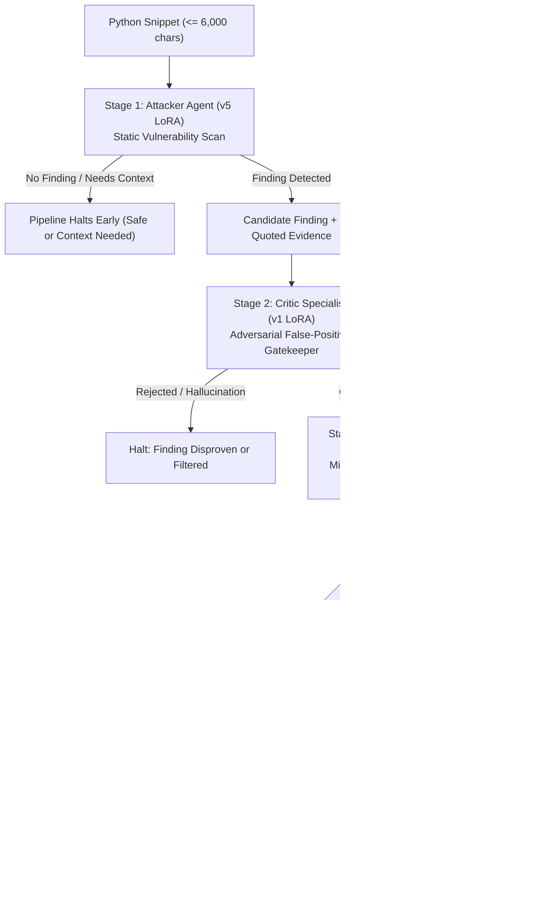

# Security Red-Teamer

<div align="center">

[](https://www.python.org/)
[](https://pytorch.org/)
[](https://fastapi.tiangolo.com/)
[](https://react.dev/)
[](https://vitejs.dev/)
[](https://github.com/huggingface/peft)
[](LICENSE)

**An adversarial, multi-agent AI vulnerability review and AST-grounded patch proposal engine for Python.**

[Architecture](#-system-architecture) •
[Quickstart](#-quickstart) •
[Installation](#-installation--setup) •
[API Reference](#-api-reference) •
[Model Weights](#-model-files--adapters) •
[Training Guide](#-qlora-training--fine-tuning) •
[Troubleshooting](#-troubleshooting)

</div>

---

## 📌 Overview

**Security Red-Teamer** is an automated code security assistant designed to eliminate hallucinations and false positives in AI vulnerability detection. 

Rather than relying on a single monolithic prompt, Red-Teamer chains three specialized **LoRA adapters** attached to a single in-memory **Qwen3-4B** base model (quantized in 4-bit NF4 for consumer GPUs with $\le$ 6 GB VRAM):

1. **Stage 1 — Attacker Agent (`v5`)**: Scans code statically for common vulnerabilities (SQLi, Command Injection, Path Traversal, SSRF, Hardcoded Secrets, etc.) and quotes verbatim evidence.
2. **Stage 2 — Critic Specialist (`v1`)**: Acts as an adversarial gatekeeper. It independently verifies whether the Attacker's evidence exists in the visible code and checks if active sanitizers already neutralize the threat. Only grounded, verified findings advance.
3. **Stage 3 — Patcher Specialist (`v3.1`)**: Produces targeted, minimal replacement blocks (`old` $\to$ `new`) and regression test invariants. Edits must pass strict deterministic AST parsing and simulated `git apply --check` before a diff is displayed.

> **Strict Read-Only Guarantee**: Security Red-Teamer **never** modifies repository files or executes untrusted code. It generates unified diffs and invariants exclusively for human developer review.

---

## 🏗 System Architecture



---

## ⚡ Quickstart

We provide one-click scripts that auto-detect virtual environments and bootstrap dependencies.

### Option A: Windows (PowerShell / CMD)
1. **Terminal 1 (Backend API)**:
   ```powershell
   .\start_backend.bat
   ```
2. **Terminal 2 (React Frontend)**:
   ```powershell
   .\start_frontend.bat
   ```
3. Open **`http://localhost:5173/review`** in your browser.

---

### Option B: Linux / WSL (Ubuntu)
1. **Terminal 1 (Backend API)**:
   ```bash
   ./start_backend.sh
   ```
2. **Terminal 2 (React Frontend)**:
   ```bash
   npm run dev --prefix frontend
   ```
3. Open **`http://localhost:5173/review`**.

---

## 💻 Installation & Setup

### 1. Prerequisites
- **Python**: 3.10 – 3.13
- **Node.js**: 20+ (with npm)
- **NVIDIA GPU**: RTX 3050/4050 (6GB+ VRAM) with CUDA installed (or Google Colab T4).

### 2. Backend Setup
Create and activate your Python virtual environment:

```powershell
# Windows
py -3.13 -m venv .venv
.\.venv\Scripts\activate

# Linux / WSL
python3 -m venv .venv
source .venv/bin/activate
```

Install PyTorch with CUDA support matching your system from [pytorch.org](https://pytorch.org/get-started/locally/):
```powershell
# Example for CUDA 12.4 / 12.6:
pip install torch --index-url https://download.pytorch.org/whl/cu124
```

Install the remaining dependencies:
```powershell
pip install -r requirements.txt
```

### 3. Frontend Setup
```powershell
cd frontend
npm install
cd ..
```

---

## 🧠 Model Files & Adapters

Git tracks the runtime logic and validation guardrails, but **not** large binary weights. Obtain the adapter weights from your team's storage and arrange them as follows:

```text
RedTeamer/
├── security-redteamer-qwen3-lora-v5/        # Attacker LoRA (v5)
│   ├── adapter_config.json
│   ├── adapter_model.safetensors
│   ├── tokenizer.json
│   └── tokenizer_config.json
├── critic_agent/
│   └── critic_v1_export/
│       ├── critic_runtime.py               # (Tracked in Git)
│       └── adapter/                        # Critic Specialist LoRA (v1)
│           ├── adapter_config.json
│           ├── adapter_model.safetensors
│           ├── tokenizer.json
│           └── tokenizer_config.json
└── patcher_agent/
    └── patcher_v31_export/
        ├── patcher_runtime.py              # (Tracked in Git)
        └── adapter/                        # Patcher Specialist LoRA (v3.1)
            ├── adapter_config.json
            ├── adapter_model.safetensors
            ├── tokenizer.json
            └── tokenizer_config.json
```

> **Base Model**: On first load, the app automatically downloads `Qwen/Qwen3-4B` from Hugging Face into `.hf_cache/`. All three adapters bind to this shared base model in VRAM.

---

## 📡 API Reference

The FastAPI backend runs on `http://127.0.0.1:8000` (interactive OpenAPI docs at `http://127.0.0.1:8000/docs`).

### 1. Health & Status
* **`GET /health`** or **`GET /`**:
  Returns service status, model load flag, and active GPU device.
* **`GET /api/model/status`**:
  Returns current adapter list and VRAM allocation state.

### 2. Load Model into GPU
* **`POST /api/model/load`**:
  Loads `Qwen/Qwen3-4B` in 4-bit NF4 quantization and attaches the Attacker, Critic, and Patcher adapters.
  ```json
  {
    "status": "ready",
    "is_loaded": true,
    "device": "NVIDIA GeForce RTX 4050 Laptop GPU"
  }
  ```

### 3. Review Code (Server-Sent Events)
* **`POST /api/review`**:
  Accepts a JSON payload `{"code": "<python snippet>"}` and streams real-time SSE events:
  - `attacker_start` / `attacker_done`
  - `critic_start` / `critic_done`
  - `patcher_start` / `patcher_done`
  - `complete` (or `error`)

---

## 🎓 QLoRA Training & Fine-Tuning

The repository includes [`attacker_agent_qwen3_qlora_complete.py`](file:///d:/projects/RedTeamer/attacker_agent_qwen3_qlora_complete.py) for reproducible fine-tuning on Google Colab or local hardware.

```powershell
python attacker_agent_qwen3_qlora_complete.py
```

### Key Training Highlights:
- **Base Model**: `Qwen/Qwen3-4B`
- **Quantization**: 4-bit NormalFloat4 (NF4) with Double Quantization (`bitsandbytes`)
- **LoRA Configuration**: $r=32$, $\alpha=64$, targeting all linear projection layers (`q_proj`, `k_proj`, `v_proj`, `o_proj`, `gate_proj`, `up_proj`, `down_proj`)
- **Optimizer**: Paged AdamW 8-bit (`paged_adamw_8bit`) with cosine learning rate scheduling
- **Validation**: Template-held-out splits ensuring generalization across unseen code idioms.

---

## 🛡️ Deterministic Guardrails

Before any patch proposal is presented in the UI, it undergoes rigorous programmatic validation:

| Check | Tool / Engine | Purpose |
| :--- | :--- | :--- |
| **AST Parse** | Python `ast.parse` | Guarantees remediated code is syntactically valid Python. |
| **Scope & Undefined Names** | Scope analysis via `ast.walk` | Ensures the patch introduces no undefined variables, invalid imports, or broken closures. |
| **Line Bounds** | Line Diff Analyzer | Enforces targeted patches ($\le 60$ modified lines) to prevent destructive rewrites. |
| **Simulated `git apply`** | Deterministic line patcher | Verifies that proposed edit chunks match unique spans in the source snippet. |
| **One-Shot Repair** | Auto-retry feedback | If a quote escape fails, prompts the model with validator diagnostics for a 1-shot recovery. |

---

## 🔧 Troubleshooting

### 1. `ECONNREFUSED 127.0.0.1:8000` (WSL / Windows)
If running Vite in WSL and the backend on Windows (or vice versa), `127.0.0.1` inside WSL connects to WSL's own loopback. 
* **Fix**: Our [`frontend/vite.config.ts`](file:///d:/projects/RedTeamer/frontend/vite.config.ts) automatically detects WSL and dynamically forwards proxy requests to the Windows host gateway (`http://<WSL_GATEWAY>:8000`). Make sure `start_backend.bat` is running.

### 2. `WinError 1455: The paging file is too small`
When loading 4-bit quantized shards into system memory before GPU transfer, Windows virtual memory allocation may hit commit limits.
* **Fix**: Increase the Windows Virtual Memory (paging file) size to at least 16–24 GB in **System Properties $\to$ Performance $\to$ Advanced $\to$ Virtual Memory**, or run `wsl --shutdown` to reclaim system RAM.

### 3. Missing Virtual Environment Packages
If running `python server.py` using global Python, the script automatically re-executes itself inside `.venv\Scripts\python.exe`.

---

## ⚖️ License & Ethical Disclosure

Distributed under the **MIT License**.

> **Defensive Use Notice**: Security Red-Teamer is intended solely for authorized defensive review and educational evaluation of source code. It does not scan external infrastructure, execute dynamic payloads, or produce offensive exploits. Always inspect generated patches and execute unit tests prior to deployment.
